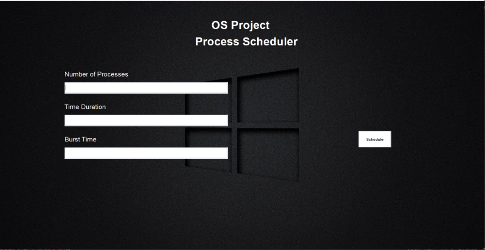
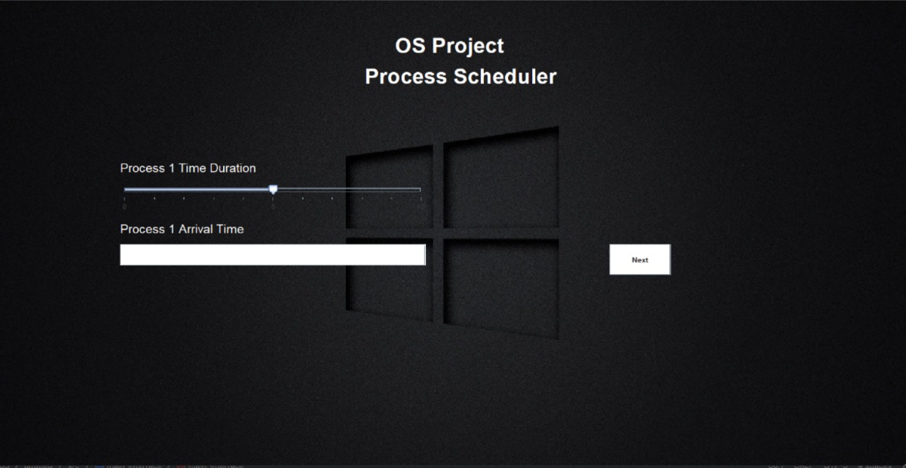
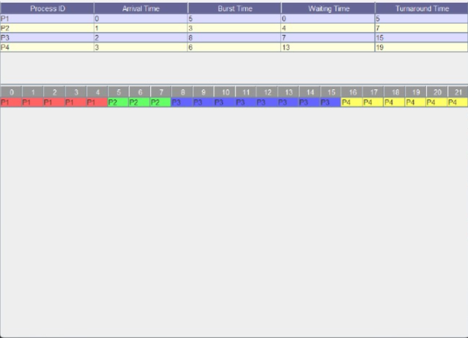

# CPU and Disk Scheduling Algorithm Simulator

A Java Swing desktop application for exploring CPU and disk scheduling. The CPU
module accepts process data and shows scheduling results as a table/Gantt chart
or progress bars. The disk module animates disk-head requests on a chart.

## Problem statement

Operating systems use scheduling policies to decide which process or disk
request is served next. Comparing policies by hand can make their ordering and
timing difficult to follow. This project provides a visual, interactive way to
enter CPU process data and observe a simulated schedule, and to view disk-head
movement for generated requests.

## Objectives

- Provide a graphical interface for selecting CPU or disk scheduling.
- Collect CPU process attributes and display calculated timing results.
- Visualize CPU execution with a Gantt-style table or progress bars.
- Animate disk requests and head movement with a JFreeChart chart.
- Keep the implementation accessible as a small Java project without a build
  system.

## Features and algorithms

### CPU scheduling

The CPU results view in `Table.java` implements:

- **FCFS (First-Come, First-Served):** non-preemptive; selects the arrived
  process with the earliest arrival time.
- **SJF (Shortest Job First):** non-preemptive; selects the shortest burst
  among processes that have arrived.
- **Priority:** non-preemptive; selects the lowest numeric priority among
  arrived processes.
- **Round Robin:** preemptive, with a fixed time quantum of 3; the results
  scheduler adds processes to the ready queue as their arrival times are
  reached.

The results view displays process start/completion times, waiting time,
turnaround time, averages, and a per-time-unit Gantt chart. The separate
progress-bar view also contains FCFS, SJF, Priority, and Round Robin execution
paths; their arrival-time behavior is not equivalent to the results view
(details are in [Known limitations](#known-limitations)).

### Disk scheduling

`DiskSchedulingSimulation.java` offers these options in its algorithm selector:

- **FCFS (First-Come, First-Served)**
- **SSTF (Shortest Seek Time First)**
- **SCAN**
- **C-SCAN**
- **LOOK**
- **C-LOOK**

The simulation generates 20 requests in the cylinder range 0-199 and starts the
head at cylinder 100. A JFreeChart line chart displays the generated request
sequence over time.

### Other source code

The project also includes an RMS/EDF real-time scheduling screen and scheduler
code in `RT_Scheduler.java` and `Execution.java`. This path is separate from the
CPU and disk flows above and has limitations, including a continuously running
simulation loop and a fixed-size Gantt chart.

## Technologies

- **Java** for the application and scheduling logic.
- **Swing** for desktop windows, forms, tables, and progress bars.
- **JFreeChart 1.5.6** for the disk-head movement chart. The project includes
  `jfreechart-1.5.6.jar` in its root directory.

The project has no Maven or Gradle build file. Java source files use the
default package and are compiled from the project root.

## Project structure

```text
.
|-- Main.java                         # Application entry point and mode selector
|-- Scheduler.java                    # CPU algorithm and process-count selection
|-- main_interface.java               # CPU / real-time process input forms
|-- Console.java                      # CPU / real-time visualization choices
|-- Table.java                        # CPU metrics and Gantt chart
|-- ProgressBar.java                  # Animated CPU progress bars
|-- DiskSchedulingSimulation.java     # Disk request chart and algorithm selector
|-- RT_Scheduler.java                 # Real-time algorithm selection
|-- Execution.java                    # Real-time scheduling visualization
|-- PriorityGui.java                  # Standalone legacy priority form
|-- RealTimeSchedulingGUI.java        # Empty placeholder class
|-- Task.java                         # Standalone task model, not wired into the UI
|-- MIPS_ISA.java                     # Unrelated MIPS scratch/stub class
|-- jfreechart-1.5.6.jar              # Disk chart dependency
|-- os_background.jpeg                # Application background image
|-- os-main-dashboard.png             # Dashboard screenshot
|-- os-process-scheduler.png          # Process scheduler screenshot
|-- os-process-scheduler-output.png   # Scheduling output screenshot
|-- ProgressBar.png                   # Progress bar screenshot
|-- schedule.png                      # Schedule screenshot
|-- table.png                         # Table screenshot
|-- textfield_color.png               # Form screenshot
```

## Requirements

- Windows
- JDK 8 or later (the source uses Java 8 language features such as lambdas)
- The included `jfreechart-1.5.6.jar` for compiling and running the disk
  scheduling module
- The image assets listed above are included in the project root. Several
  windows use a machine-specific absolute path for the background image, so
  that background may not appear on another computer.

## Compile and run on Windows

Open PowerShell and change to the project root (the directory containing
`Main.java` and `jfreechart-1.5.6.jar`):

```powershell
Set-Location "C:\path\to\OS-CPU-Disk-Scheduling-Simulator-main"

$sources = Get-ChildItem -Filter '*.java' | ForEach-Object { $_.Name }
javac -cp ".;jfreechart-1.5.6.jar" $sources

java -cp ".;jfreechart-1.5.6.jar" Main
```

The main window lets you choose Normal Schedule, Real_Time Schedule, or Disk
Schedule. To launch the disk demo directly after compilation:

```powershell
java -cp ".;jfreechart-1.5.6.jar" DiskSchedulingSimulation
```

The commands use Windows classpath separators (`;`). Compilation writes
`.class` files into the project directory.

## Screenshots

All links below are relative to the repository root.

### Main dashboard



### CPU process scheduler



### CPU scheduling results



### Additional UI screenshots


## Testing

No automated test suite or test/build configuration is present in the project
files. No automated test results are claimed here. A basic manual check is to
compile all source files with the command above, launch `Main`, and open the CPU
and disk screens. CPU results can be inspected in the table and Gantt chart;
the disk chart can be observed while it services its generated requests.

## Known limitations

- There is no Maven/Gradle build configuration; compile and run from the project
  root with the bundled JFreeChart JAR on the classpath.
- Several Swing screens load `os_background.jpeg` from an absolute path on the
  original development machine. The image is included, but those screens may
  show no background elsewhere.
- The CPU results view handles arrival times for SJF and Round Robin. However,
  the input form does not ask for arrival times for Round Robin and assigns
  incrementing values internally. The progress-bar Round Robin scheduler does
  not process arrivals as they occur. The progress-bar SJF and Priority paths
  sort their process list without selecting only arrived processes.
- The Priority input form displays an arrival-time field, but its current
  handler does not read that field when creating a process; processes therefore
  use the default arrival time in the CPU results view.
- The disk SSTF option sorts requests by distance from the initial head
  position, rather than recalculating the nearest request after every seek.
  SCAN, C-SCAN, LOOK, and C-LOOK currently use the same ascending request
  ordering; their direction/wrap behavior is not implemented as distinct
  algorithms.
- The real-time scheduler runs continuously and its Gantt chart has a fixed
  number of time columns. The real-time Progress Bar button is not wired to an
  action.
- The input forms parse text directly as integers and do not provide complete
  validation for invalid or empty input.

## Attribution and license

The files in this project snapshot do not identify an original author or
upstream repository, and no `LICENSE` file is present. The local Git history
does not establish the original source attribution. Accordingly, this README
does not assign authorship or claim a license. Confirm the original source and
its licensing terms before redistribution or reuse.
